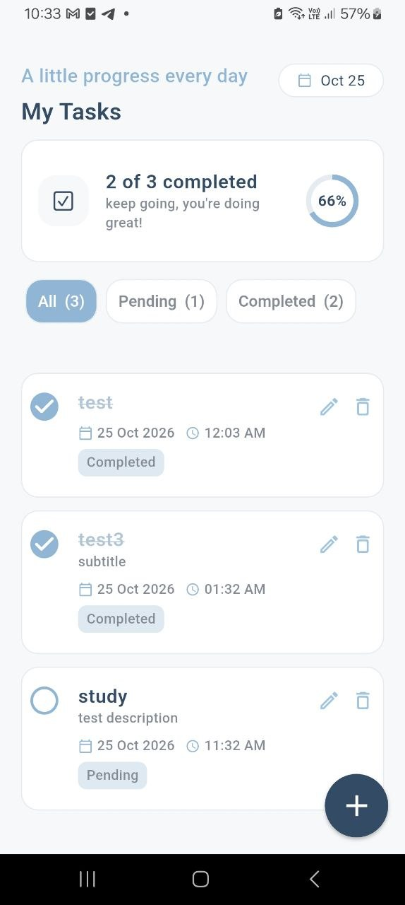
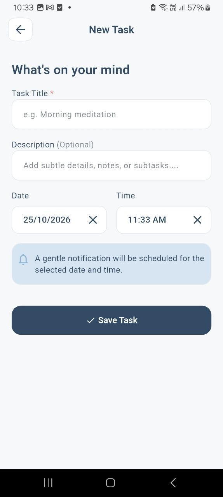
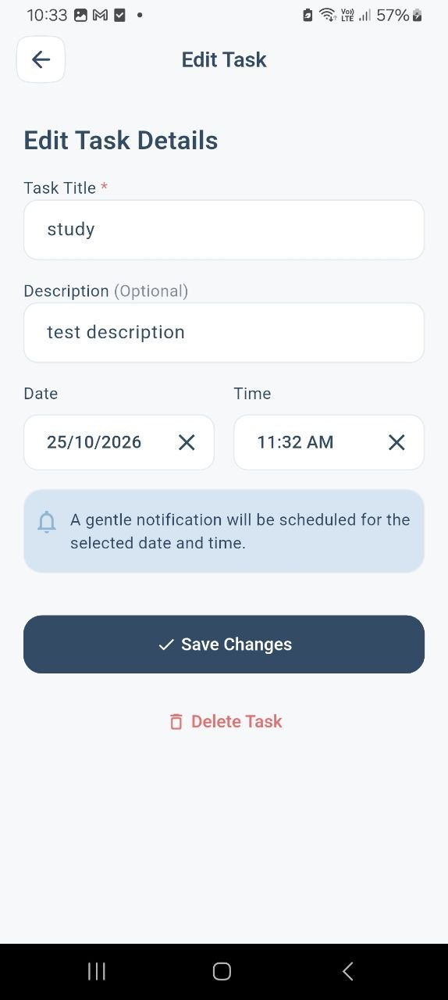
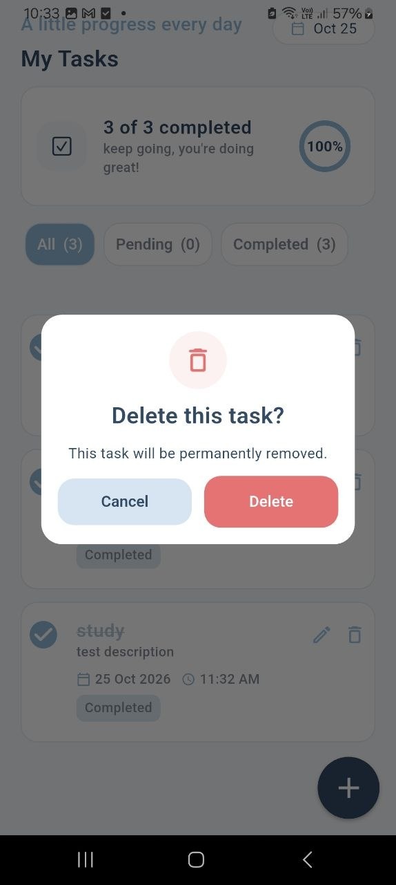
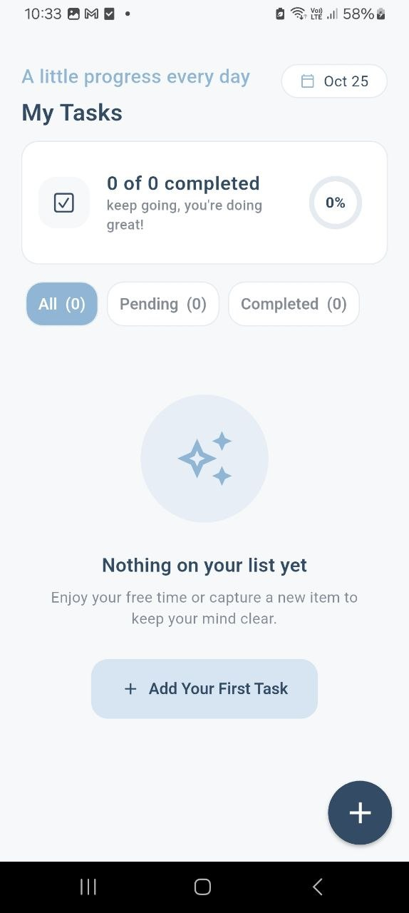
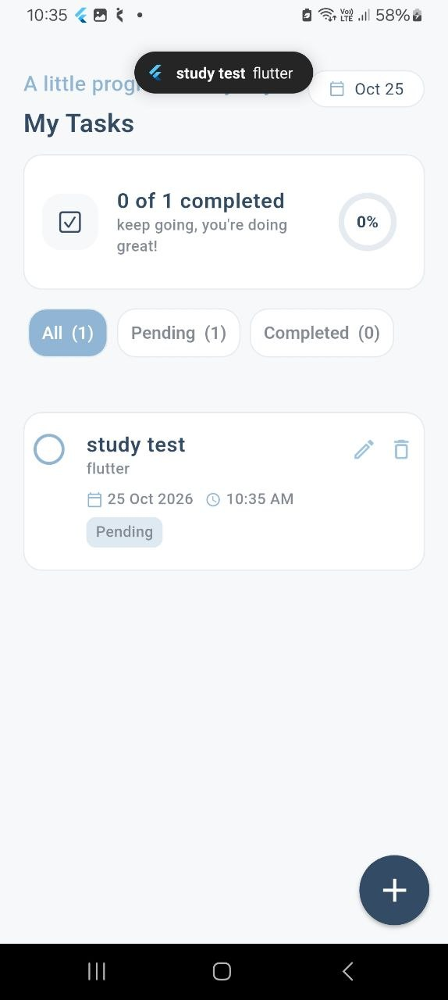

# To-Do App (Flutter)

A local-first to-do app built with Flutter. Tasks are stored on the device with
SQLite, state is managed with Cubit (flutter_bloc), and reminders are delivered
as local notifications. No backend, no Firebase.

## Features

- Add, edit and delete tasks (title required, description optional, date & time)
- Mark tasks as Completed / Pending with a checkbox (saved in SQLite)
- Filter: All / Pending / Completed
- Local notification at the task's date & time
  - rescheduled when the time is edited
  - cancelled when the task is deleted or completed
- Form validation (empty title, reminder time must be in the future)
- Delete confirmation dialog, empty states, snackbar feedback
- Overdue indicator and a progress card (completed vs. total)
- Data survives app restarts

## Tech Stack

| Purpose            | Package                       |
| ------------------ | ----------------------------- |
| State management   | `flutter_bloc` (Cubit)        |
| Local database     | `sqflite`, `path`             |
| Notifications      | `flutter_local_notifications`, `timezone` |
| Date/time          | `intl`, `date_field`          |

## Architecture

```
lib/
├── core/            # theme, colors, typography, services
│   └── services/notification_service.dart
├── data/            # TaskModel + DatabaseHelper (SQLite)
├── logic/           # TasksCubit + states
└── presentation/    # screens and widgets
```

The UI never touches the database. It calls `TasksCubit`, which updates SQLite
and the notifications, then emits a new state that the UI rebuilds from.

```
UI ──► TasksCubit ──► DatabaseHelper (SQLite)
          │      └──► NotificationService
          └── emit(State) ──► UI
```

A task's SQLite `id` is also used as its notification id, which is how a task's
notification is updated or cancelled.

## Getting Started

Requirements: Flutter SDK (stable), Android Studio or Xcode, a device or emulator.

```bash
git clone <your-repo-url>
cd to_do_app
flutter pub get
flutter run
```

### Android notes

- On Android 13+ the app asks for notification permission on first launch.
- Exact alarms may require allowing "Alarms & reminders" in system settings;
  otherwise reminders may arrive slightly late.
- `flutter_local_notifications` needs core library desugaring enabled in
  `android/app/build.gradle.kts` (see the package documentation).

### iOS notes

Run `cd ios && pod install` once, then `flutter run`. Allow notifications when
prompted.

## Screenshots

| Home | Add Task | Edit Task |
| ---- | -------- | --------- |
|  |  |  |

| Delete dialog | Empty state | Notification |
| ------------- | ----------- | ------------ |
|  |  |  |

Screen recording: [demo video](screen_shot/demo.mp4)

## Author

Basma Ali